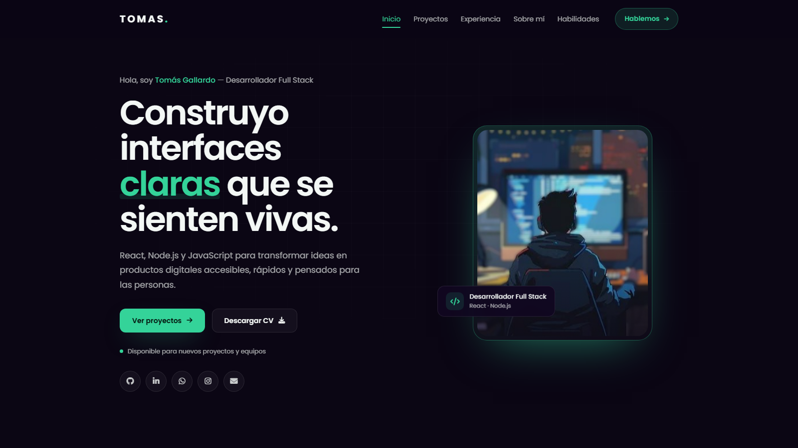

<div align="center">

# Tomás Gallardo

### Desarrollador Full Stack

Construyo productos web completos: interfaces claras, lógica de negocio y datos bien resueltos.

[](#contacto)
[](https://www.linkedin.com/in/tomas-diego-gallardo)
[](https://github.com/tomasgallardo-dev)
[](mailto:tomasgallardo272@gmail.com)

[Ver CV](./public/CV-Tomas-Gallardo-Full-Stack-Developer.pdf) · [Proyectos](#proyectos-destacados) · [Contacto](#contacto)

</div>

---

## Vista previa



---

## Sobre mí

Soy desarrollador Full Stack con formación técnica en programación y experiencia construyendo aplicaciones web de punta a punta.

Trabajo con **React, JavaScript, Node.js y Supabase**, y disfruto especialmente los proyectos donde hay que conectar una buena interfaz con reglas de negocio reales: autenticación, ventas, inventario, reportes y persistencia de datos.

Vengo de siete años en operaciones ferroviarias, un entorno donde aprendí a trabajar con protocolos, resolver incidencias bajo presión y hacerme responsable del resultado. Hoy traslado esa misma disciplina al desarrollo de software.

**Busco mi próxima oportunidad como Desarrollador Full Stack o Frontend.**

---

## Proyectos destacados

| Proyecto | Qué resuelve | Stack | Enlaces |
| --- | --- | --- | --- |
| **Hercules PetShop** | E-commerce con catálogo, carrito y experiencia de compra responsive. | React · JavaScript · CSS | [Demo](https://e-commerce-pet-shop.vercel.app/) · [Código](https://github.com/tomasgallardo-dev/E-commerce-PetShop) |
| **Dyto Social** | Sitio institucional para una consultora de marketing digital, con identidad editorial y formulario de contacto. | React · Vite · CSS | [Demo](https://pagina-dyto-social-web.vercel.app/) · [Código](https://github.com/tomasgallardo-dev/pagina-Dyto-social-web) |
| **Sistema de Facturación** | Gestión comercial con autenticación, multiempresa, ventas, control de stock, reportes y exportación de datos. | React · Supabase · PostgreSQL · Vite | [Código](https://github.com/tomasgallardo-dev/sistema-facturacion) |
| **Calculadora Interactiva** | Operaciones matemáticas al instante con tema claro/oscuro y manejo de estado. | React · JavaScript · CSS | [Código](https://github.com/tomasgallardo-dev/calculadora-claro-oscuro) |

---

## Tecnologías

| Frontend | Backend y datos | Herramientas |
| --- | --- | --- |
| React | Node.js | Git y GitHub |
| JavaScript | Supabase | Vite |
| HTML5 y CSS3 | PostgreSQL / MySQL | Vercel |
| TypeScript | MongoDB | ESLint |
| Diseño responsive | APIs REST | npm |

---

## Lo que aporto

- **Interfaces cuidadas:** experiencias responsive, accesibles y con jerarquía visual clara.
- **Lógica de negocio:** flujos de venta, stock, autenticación y reportes que funcionan de punta a punta.
- **Datos consistentes:** consultas, validaciones y operaciones atómicas del lado del servidor.
- **Aprendizaje continuo:** formación constante y proyectos reales para incorporar nuevas herramientas.

---

## Formación

- **Técnico en Programación** — Teclab Instituto Técnico Superior (2025)
- **Desarrollo Web con React** — CoderHouse (2026)

---

## Ejecutar el proyecto

```bash
git clone https://github.com/tomasgallardo-dev/mi-portafolio-web.git
cd mi-portafolio-web
npm install
npm run dev
```

Para generar la versión de producción:

```bash
npm run build
npm run preview
```

El proyecto no requiere variables de entorno.

---

## Contacto

- **Email:** [tomasgallardo272@gmail.com](mailto:tomasgallardo272@gmail.com)
- **LinkedIn:** [linkedin.com/in/tomas-diego-gallardo](https://www.linkedin.com/in/tomas-diego-gallardo)
- **GitHub:** [github.com/tomasgallardo-dev](https://github.com/tomasgallardo-dev)
- **CV:** [Descargar PDF](./public/CV-Tomas-Gallardo-Full-Stack-Developer.pdf)

---

<div align="center">

Si te interesa mi perfil o querés conversar sobre una oportunidad, escribime. Siempre estoy abierto a aprender y construir cosas nuevas.

</div>
